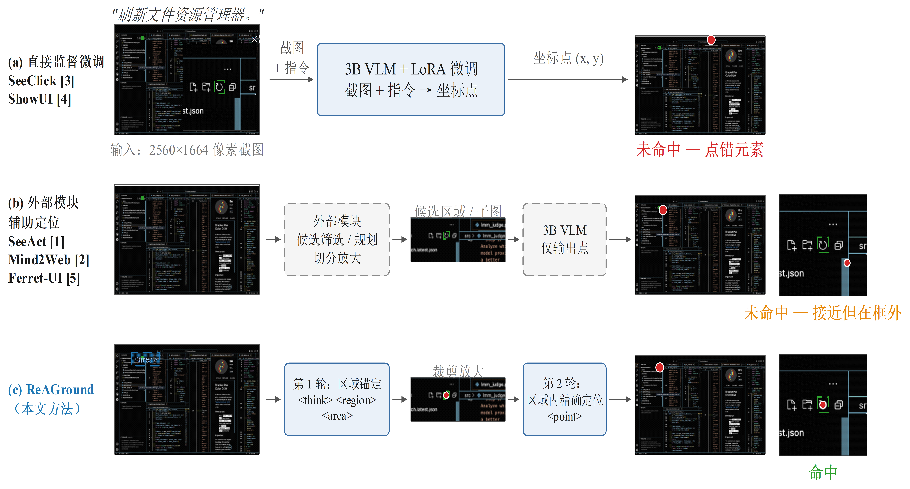

# ReAGround: Region-Anchored Two-Stage GUI Grounding for High-Resolution Interfaces

<p align="center">
  
</p>

**ReAGround** is a lightweight GUI grounding method: a Qwen2.5-VL-3B backbone,
LoRA fine-tuning (rank 8, &alpha;=16), and a *region-anchored two-stage*
inference protocol in which the model first names the functional **area** of
the target element and then outputs the exact **point** inside the cropped,
upscaled region. Everything runs on a single consumer GPU (one RTX 4090, 2–3 h
per training run).

> Status: code release of an ongoing undergraduate-thesis project.
> Result tables are intentionally left as TBD until the controlled experiments
> finish — no number in this repo is fabricated.

## News

- **[2026-10]** Code release: evaluation harness, data builder, LoRA training
  with section-weighted loss, two-stage inference.
- **[2026-10]** First controlled run finished on a single A10 (groups A and D,
  1 epoch each); preliminary numbers below, full log in [REPORT.md](REPORT.md).

## Method

| Problem on high-resolution GUIs | ReAGround's answer |
|---|---|
| Tiny targets get visually diluted after the VLM's image resize ("can't see") | **Zoom-in**: anchor a coarse area, crop and let `smart_resize` upscale it, then point |
| Weak GUI structural knowledge ("can't find the right place") | **Region CoT**: the model first judges the functional area (`<think>/<region>/<area>`), then points inside it (`<point>`) |

Training is plain SFT on a new output protocol — no architecture change.
Supervision falls only on verifiable facts (region name and area box are
rule-derived from the GT box; the point is the GT center):

```
L = 0 * L_think + 1 * L_region + 1 * L_point (+ 1 * L_format)
```

where each L is the per-section mean cross-entropy (see `train/dataset.py`).
The think segment is free reasoning and excluded from the loss.

## Controlled experiment design

Same backbone, same LoRA config, same 8K subset, same eval protocol — one
variable at a time:

| Group | Recipe | Question |
|---|---|---|
| A | 8K + plain LoRA SFT (direct point) | cost of 3x less data |
| B | A + point-anchored zoom (ReGround-style) | value of zoom alone *(planned)* |
| C | A + region CoT, no zoom | value of structure reasoning alone *(planned)* |
| D | A + region CoT + zoom (**ReAGround**) | total gain |
| E | ZonUI-3B official weights (24K) | external reference to surpass |

## Preliminary results (first controlled run, 2026-10)

ScreenSpot point-in-bbox accuracy; per-sample outputs land in `outputs/`
(not tracked) and the full gate-by-gate log is in [REPORT.md](REPORT.md).

| Model | Pro avg | Pro text | Pro icon | v2 avg |
|---|---|---|---|---|
| Qwen2.5-VL-3B (base, direct prompt) | 1.5% | 2.3 | 0.2 | — |
| Group A (8K direct SFT) | 20.7% | 30.0 | 5.6 | 85.8% |
| ReAGround (group D, grid-area labels) | 22.3% | 31.1 | 7.9 | 63.7%\* |

\* Group D's v2 number is partial — the run was interrupted at 957/1272
samples. Published references our harness should reproduce *before* trusting
any trained number: ZonUI-3B ≈ 29.0% and base Qwen2.5-VL-3B ≈ 16.0% on
ScreenSpot-Pro (see `scripts/eval_zonui_pro.sh`). Our measured base number of
1.5% deviates mainly because the direct prompt yields prose instead of points
on 63% of samples (weights and inference verified healthy) — the ZonUI-3B
golden check is still pending.

## Known issue / next step

In this snapshot, group D's round-1 `<area>` labels are the 4×2 **grid cell**
containing the GT center (unioned with the GT box,
`data/build_dataset.py::area_box`) — i.e. "which of 8 blocks", deliberately
coarse in the original plan. This deviates from the intended design, in which
round 1 should output the *actual* GT box (normalized, 3-decimal). Group D
will be retrained on rebuilt labels; the round-2 training-crop strategy
(margin/jitter around the box, to avoid the degenerate "always answer the
crop center" solution) is under evaluation. Group A is unaffected.

## Installation

Tested: Python 3.9, torch 2.1.2+cu121, `transformers==4.49.0` (newer versions
break with torch 2.1 — do not upgrade blindly).

```bash
pip install -r requirements.txt
```

On a fresh GPU server (e.g. AutoDL), `bash scripts/setup_server.sh` installs
deps and downloads both model weights and both benchmarks (via hf-mirror).
An optional [Dockerfile](docker/Dockerfile) is provided for servers with full
root; rental platforms without a docker daemon should use the pip path.

## Data preparation

Benchmarks (evaluation only, never trained on):

- ScreenSpot-Pro (`likaixin/ScreenSpot-Pro`), 1581 samples
- ScreenSpot-v2 (`HongxinLi/ScreenSpot_v2`), 1272 samples

Training corpora (same public sources as ZonUI-3B):

```bash
python data/download_corpus.py        # ShowUI-web / ShowUI-desktop / UGround (gated)
# AMEX: manual steps printed by the script (https://www.yxchai.com/AMEX)

python data/build_dataset.py --config configs/data_recipe.yaml --fmt twostage
# -> data/outputs/train_twostage.jsonl (16K sequences) + val.jsonl (250 held-out)
```

Sampling: platform-balanced (web/mobile/desktop ≈ 1:1:1), fixed seed, at most
30 entries per unique screenshot (the desktop corpus contains only ~100 unique
screenshots). All area/region/point labels are rule-derived from GT boxes —
no human annotation added. ShowUI-web ships element descriptions, not task
queries; we synthesize the query with a documented template
(`data/build_dataset.py::iter_showui_web`).

## Training

```bash
python train/train_lora.py --config configs/train_lora.yaml          # group D
python train/train_lora.py --config configs/train_lora.yaml --dry-run # 2-step sanity run
```

LoRA rank 8 / &alpha;=16 on attention+MLP projections, bf16, batch 1 ×
grad-accum 48, lr 2e-4, cosine — matching ZonUI-3B's recipe. Only the adapter
is saved.

### Training details

Supervision is section-weighted token cross-entropy. Each target sequence is
split into sections by char spans, mapped to tokens via the fast tokenizer's
offset mapping so boundaries can never drift (`train/dataset.py`):

| Section id | Content | Weight |
|---|---|---|
| 1 | `<think>` free reasoning | 0 (unsupervised) |
| 2 | `<region>…</area>` block | 1 |
| 3 | `<point>…</point>` or direct `(x, y)` | 1 |
| 4 | protocol tokens (`<think></think>` tags, `<|im_end|>`) | 1 |

`L = Σ_s λ_s · mean_CE(section s)` (`train/train_lora.py::SectionalTrainer`);
per-section averaging prevents the long think segment from dominating, and
lambdas live in `configs/train_lora.yaml`. This is plain SFT on the output
protocol — there is no spatial/box regression loss; "point inside bbox" is
only the *evaluation* criterion.

Full hyperparameters (identical for both groups): LoRA r 8 / &alpha; 16 /
dropout 0.05, bf16, flash-attention-2, batch 1 × grad-accum 48, lr 2e-4 with
cosine schedule, 1 epoch, seed 42. On our A10 (150 W cap) one step costs
~110–135 s: group A (166 steps) ≈ 4.6 h, group D (333 steps) ≈ 10 h, plus
~1–2 h of evaluation per benchmark.

## Evaluation

```bash
# golden check first: reproduce ZonUI-3B ~29.0% on ScreenSpot-Pro
bash scripts/eval_zonui_pro.sh

# ReAGround, two-stage inference
python eval/eval_screenspot.py --benchmark pro --data-dir benchmarks/screenspot_pro \
    --model models/Qwen2.5-VL-3B-Instruct --adapter outputs/reaground_lora \
    --mode twostage --out outputs/group_d_pro.jsonl
```

Per-sample JSONL output feeds directly into error decomposition (hit / near-miss
/ far-miss). `tests/test_core.py` covers parsing, coordinate round-trips, the
section-weighted loss math, and the sequence builders — run it before trusting
any number.

## Repository structure

```
protocol.py             prompts, tags, resize budget, model I/O (single source of truth)
eval/eval_screenspot.py ScreenSpot-v2 / Pro / held-out-set evaluation
infer/parse.py          output parsing + coordinate mapping (self-tested)
infer/pipeline.py       direct and two-stage inference
data/download_corpus.py training-corpus download (HF mirror aware)
data/build_dataset.py   8K sampling + two-stage sequence construction
train/dataset.py        tokenization with per-token loss sections
train/train_lora.py     LoRA SFT + section-weighted loss trainer
configs/                all hyperparameters (data recipe, LoRA, lambdas)
scripts/                server setup + per-group run scripts
tests/                  unit tests (no GPU needed)
docker/                 optional Dockerfile
```

## Acknowledgement

[Qwen2.5-VL](https://arxiv.org/abs/2502.13923),
[ZonUI-3B](https://github.com/Han1018/ZonUI-3B) (baseline recipe and protocol),
[ShowUI](https://github.com/showlab/ShowUI),
[UGround](https://github.com/OSU-NLP-Group/UGround),
[AMEX](https://www.yxchai.com/AMEX),
[ScreenSpot-Pro](https://github.com/likaixin2000/ScreenSpot-Pro-GUI-Grounding).

## Citation

Thesis manuscript in preparation; citation entry will be added upon publication.

## License

Apache-2.0 (code). The training corpora keep their own licenses — UGround data
is CC BY-NC-SA 4.0 (non-commercial use only).
